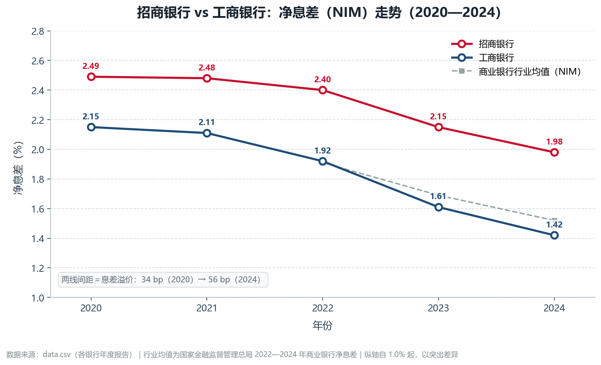
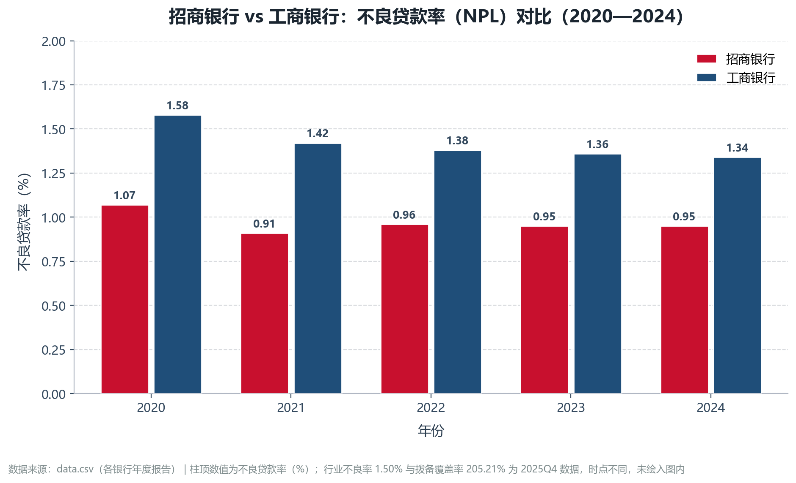

# 上市银行净息差与不良率对比分析工具

> 用 Python 把「银行年度经营指标表」变成「两张可直接进报告的图 + 一份可复核的数字摘要」。
>
> 课程：金融市场与金融机构　｜　版本：v0.3.0　｜　作者：李林韩（3202610133）
>
> 仓库：<https://github.com/ZHAO-417/bank-nim-analyzer>　｜　许可证：[MIT](LICENSE)

---

## 一、项目背景

利率市场化推进与 LPR 连续下调之下，中国银行业的净息差（NIM）进入长期收窄通道：贷款端重定价快于存款端，资产收益率下行而负债成本相对刚性。与此同时，监管部门对资产质量的穿透式管理趋严，不良贷款率（NPL）成为观察银行风险抵补能力的关键窗口。

对这两项指标，常见的读法是用「股份制银行 vs 国有大行」的框架比较：

- **招商银行**：零售驱动，活期存款占比高，负债成本较低；
- **工商银行**：规模庞大，客群下沉，负债成本相对较高。

两家银行 2020—2024 年的数据，可以回答三个具体问题：息差各收窄了多少？不良率是否同步改善？两者的差距在收敛还是扩大？

本项目的目标不是写一篇纯文字报告（Paper），而是做一个**可复用的程序（Program）**，并把用法沉淀为**可被 AI 调用的技能（Skill）**——换一批银行、换一段年份，改数据即可重跑。

> 表述约定：本项目只报告**共变关系**，不使用"利率下行使息差收窄"这类因果断言。机制解释（资产端收益率与负债端成本率的分解）见第三节。

## 二、研究设计与口径

### 2.1 指标定义

| 指标 | 定义 | 单位 | 用途 |
| --- | --- | --- | --- |
| 净息差 NIM | 净利息收入 ÷ 平均生息资产 × 100% | % | 生息资产的单位产出效率 |
| 净利差 Spread | 生息资产平均收益率 − 计息负债平均成本率 | % | 只含"价格差"，不含结构效应 |
| 不良贷款率 NPL | 不良贷款余额 ÷ 贷款和垫款总额 × 100% | % | 存量信用风险暴露 |
| 拨备覆盖率 | 贷款损失准备 ÷ 不良贷款余额 × 100% | % | 风险抵补厚度 |

> **口径说明（重要）**：本报告采用**年报口径**——分子为利息净收入，分母为**平均生息资产**（工行年报注 4、招行年报同口径）。课程课件将 NIM 简写为「（利息收入−利息支出）÷ 资产」，分母为总资产；两者差异源于非生息资产（现金、固定资产）对分母的摊薄，本报告采用更严谨的年报口径，并在此留痕。所有数据为**集团口径、期末/平均余额按年报披露**，不做跨行调整。

### 2.2 样本

- 招商银行（600036.SH）、工商银行（601398.SH），2020—2024 年，共 10 个观测值；
- 数据来源：两家银行年度报告，手工整理为长表 `data.csv`；
- 变动统一用 **bp**（1 bp = 0.01 个百分点）表述；
- 2020—2024 是 LPR 改革（2019 年 8 月）落地后的首个五年，其中 2022—2024 年为 LPR 集中下调与存量按揭加点调整的集中期。

### 2.3 指标下沉与对账（v0.3.0）

v0.2 之前，程序读的是人工算好的 NIM/NPL；v0.3 起改为从原始科目计算：

| 指标 | 公式 | 输入字段 |
| --- | --- | --- |
| 净息差 NIM | （利息收入 − 利息支出）÷ 平均生息资产 | 前三个字段 |
| 不良率 NPL | 不良贷款余额 ÷ 贷款和垫款总额 | 中间两个 |
| 拨备覆盖率 | 贷款损失准备 ÷ 不良贷款余额 | 后者与不良余额 |

`data_raw.csv` 为 8 行（2 家银行 × 2021—2024）× 11 列原始科目；`metrics.py` 负责计算并与年报披露值对账：
8 行全部通过，最大偏差 NIM 0.50 bp、NPL 0.49 bp、拨备覆盖率 0.004 pp（容差 1 bp / 0.1 pp）。

**口径陷阱**：拨备覆盖率必须含 FVOCI 准备。招行 2022 年 FVOCI 准备 65.63 亿元，只算摊余会让覆盖率
从 450.79% 降到 439.47%（−11.31 pp）。`metrics.py` 同时输出两种口径，把这条做成代码里的检查，而不是文档里的一句话。

> 2020 年只有披露值（原始科目未取），因此默认 `python main.py` 用 `data.csv` 画五年图；
> `python main.py --source raw` 展示 2021—2024 的"计算版"，两者数值一致（差 ≤ 0.5 bp）。

## 三、核心发现（v0.3.0 结果）

| 银行 | 净息差 2020 → 2024 | 变动 | 不良率 2020 → 2024 | 变动 |
| --- | --- | --- | --- | --- |
| 招商银行 | 2.49% → 1.98% | **−51 bp** | 1.07% → 0.95% | **−12 bp** |
| 工商银行 | 2.15% → 1.42% | **−73 bp** | 1.58% → 1.34% | **−24 bp** |

**（1）两家息差同期收窄，工行幅度更大。** 工行五年累计 −73 bp，比招行的 −51 bp 多 22 bp；2022 年后两家斜率都变陡，与 LPR 集中下调的时间窗口一致。

**（2）息差溢价扩大，但结论对口径不敏感。** 招行相对工行的溢价由 2020 年 34 bp 扩大到 2024 年 56 bp。改用**净利差**口径复核：2024 年招行 1.86%、工行 1.23%，溢价 63 bp——方向一致、幅度相差 7 bp，说明"溢价扩大"不是 NIM 单一分母口径的产物。图中叠加了 2020—2024 年商业银行行业均值（2.10→2.08→1.91→1.69→1.52）：招行五年始终高于行业；工行 2020—2022 年略高于或持平行业，**2023 年首次低于行业**（1.61% vs 1.69%），2024 年低 10 bp。

**（3）不良率同步下行，差距收窄的实质是工行改善更快。** 工行 −24 bp、招行 −12 bp，差距由 0.51 个百分点收窄至 0.39 个百分点。招行 2021 年触及 0.91% 后基本持平（0.96→0.95→0.95），因此"差距收窄"不等于"招行资产质量变差"。

**（4）杜邦分解：招行的高 ROE 来自资产端，不是杠杆。** 2024 年招行 ROAA 1.28%、ROAE 14.49%，隐含平均股本乘数约 11.3；工行 ROAA 0.78%、ROAE 9.88%，乘数约 12.7。工行杠杆反而更高，但 ROE 仍低 4.6 个百分点——因为其单位资产盈利能力只有招行的 61%。这正是「ROE = ROA × EM」的直接含义：**杠杆可以放大收益，但放大不了效率**。

**（5）拨备厚度差异大于不良率差异。** 2024 年招行拨备覆盖率 411.98%、贷款拨备率 3.92%；工行 214.91%、2.87%。两家不良率只差 0.39 个百分点，抵补能力却接近两倍——只看不良率会低估这一差距。

**（6）关于"高定价 vs 高风险"的权衡。** 行业平均意义上，更高的资产定价往往对应客群下沉与更高的信用风险；但本样本中招行同时呈现"高 NIM + 低 NPL"，说明该权衡在个体层面并非必然。一个可检验的解释是：招行的高 NIM 来自**负债端便宜**而非资产端冒险——2024 年其计息负债平均成本率 1.64%、活期存款日均占比 50.34%。这是一个**待检验命题**，本版本只给出方向与证据，不做因果结论。

> 数据说明：第（2）—（5）项中的净利差、ROAA/ROAE、拨备覆盖率、贷款拨备率、成本收入比、活期占比均为 2024 年年报披露值，由作者手工摘录；行业均值为银保监会/国家金融监督管理总局 2020—2024 年商业银行季度指标（2020 年为原表；2021 年为三源交叉整理值；2022 年起与课件第 17 章 slide 39 同源）。

## 四、功能特性

- **标准 CSV 输入**：`data.csv` 为 UTF-8-BOM 编码的真 CSV；同时兼容旧版"改名为 .csv 的 Excel 工作簿"，经 BytesIO 读取，规避 openpyxl 3.1 对扩展名的校验；
- **指标下沉**：`metrics.py` 由原始科目（利息收支、生息资产、不良余额、贷款总额、损失准备）算 NIM、NPL、拨备覆盖率，8 行对账全部通过（NIM ≤ 0.50 bp）；
- **表头容错**：`净息差(%)`、`净息差`、`NIM`、`不良贷款率` 等写法自动归一；
- **中文不乱码**：运行时探测系统字体（Microsoft YaHei 优先，回退 SimHei），并关闭负号乱码；
- **图即报告**：数值标在点上/柱顶，图下带数据来源脚注，200 dpi 白底；
- **行业参照**：折线图叠加商业银行行业均值（仅样本年份区间），并标注"两线间距＝息差溢价"；
- **数字摘要**：终端输出透视表、均值、bp 变动与息差溢价，避免人工算错。

## 五、目录结构

仓库根目录（克隆后）：

```text
bank-nim-analyzer/        # 仓库结构；提交包按作品拆为 5 个文件夹，对应关系见 作品清单.txt
├── main.py            # 主程序：读取 → 清洗 → 透视 → 绘图 → 摘要
├── metrics.py         # 指标计算与对账：原始科目 → NIM / NPL / 拨备覆盖率
├── data.csv           # 披露值（10 行，2020—2024）
├── data_raw.csv       # 原始科目（8 行，2021—2024 × 2 家，含 FVOCI 拆分）
├── requirements.txt   # 依赖与主版本约束
├── LICENSE            # MIT
├── README.md          # 本文件
├── SKILL.md           # Agent Skill 规范：AI 如何调用本工具
├── CHANGELOG.md       # 版本日志
├── .gitignore
├── docs/
│   └── 立项草稿.md     # 立项期材料（原「我要做的.md」）
├── chart_nim.png      # 输出：净息差折线图
└── chart_npl.png      # 输出：不良率柱状图
```

期中提交包另按「学号+班级+姓名+作品名称+序号」拆为 5 件作品，见包内 `作品清单.txt`；两处内容同源，仓库为工作版本。

## 六、快速开始

### 6.1 环境要求

| 项 | 要求 |
| --- | --- |
| 操作系统 | Windows 10/11（macOS/Linux 亦可，字体列表会自动回退） |
| Python | ≥ 3.8（已验证 3.8.8） |
| 依赖 | `pandas`、`matplotlib`、`openpyxl` |
| 字体 | Microsoft YaHei 或 SimHei |

### 6.2 在 PyCharm 中运行

1. **打开项目**：`File → Open`，选择项目根目录（本地为 `program`，克隆后为 `bank-nim-analyzer`）。不要只打开 `main.py`。
2. **配置解释器**：`File → Settings → Project: <项目名> → Python Interpreter → Add Interpreter → Conda Environment → Existing environment`，选择
   `D:\Anaconda3-2021.05-Windows-x86_64\anaconda3\python.exe`。
3. **运行**：右键 `main.py → Run 'main'`。
4. **确认成功**：首行 `[版本] v0.3.0`，末行 `完成：两张图已生成。`，退出码 0。
5. **查看图片**：双击 `chart_nim.png` / `chart_npl.png`。

> 若提示 `ModuleNotFoundError`，说明解释器选错：在 PyCharm 终端执行 `pip install -r requirements.txt`。

### 6.3 命令行运行

```bash
cd <项目根目录>          # 本地为 program，克隆后为 bank-nim-analyzer
python main.py
python main.py --data data.csv --outdir outputs
python main.py --source raw          # 由原始科目计算（2021—2024）
python metrics.py                    # 指标对账表
python metrics.py --check            # 对账失败时退出码 1，可挂 CI
python main.py --version
```

脚本用 `Path(__file__).resolve().parent` 定位默认文件，因此在哪个目录执行都不影响结果。

### 6.4 从 GitHub 复现

```bash
git clone https://github.com/ZHAO-417/bank-nim-analyzer.git
cd bank-nim-analyzer

conda create -n bank-nim python=3.10 -y
conda activate bank-nim
pip install -r requirements.txt
python main.py
```

## 七、数据说明

### 7.1 字段

| 列 | 类型 | 示例 | 说明 |
| --- | --- | --- | --- |
| `银行` | 文本 | 招商银行 | 银行全称 |
| `年份` | 整数 | 2024 | 年度 |
| `净息差%` | 浮点 | 1.98 | 百分数，1.98 即 1.98% |
| `不良率%` | 浮点 | 0.95 | 百分数，同口径 |

### 7.2 关于数据格式（v0.2 已修复）

v0.1 的 `data.csv` 实际上是 Excel 工作簿，仅因 openpyxl 3.0 对扩展名宽容才能读取；**openpyxl 3.1 起会直接抛 `InvalidFileException`**，可复现性因此依赖环境版本。

v0.2 做了两件事：

1. `data.csv` 另存为**标准 UTF-8-BOM CSV**（330 字节），任何环境都能 `read_csv`；
2. 读取逻辑改为**先读字节流**：zip 容器 → `pd.read_excel(BytesIO(raw))`，纯文本 → `pd.read_csv(BytesIO(raw))`。这样即便再遇到"改了后缀的 xlsx"，也不会因扩展名校验而失败。

### 7.3 扩展新银行

在 `data.csv` 追加同样四列即可，代码零改动：

```csv
建设银行,2020,2.19,1.56
建设银行,2021,2.13,1.42
```

银行在图中出现的顺序 = 首次出现的顺序；未预置品牌色的银行自动从调色板取色。

## 八、输出说明

### 8.1 净息差折线图



- 纵轴**不从 0 起**（本例自 1.0% 起），否则 0.5 个百分点的差异会被压平；图注已披露起点，并用底部说明框标出"两线间距＝息差溢价：34 bp（2020）→ 56 bp（2024）"，避免读者高估视觉差距；
- 灰色虚线为商业银行行业均值（2020—2024 全部样本年份）：招行五年均高于行业；工行 2023 年首次低于行业（1.61% vs 1.69%），2024 年低 10 bp；
- 每个数据点标注两位小数。

### 8.2 不良率柱状图



- 同年份两家并排，柱高从 0 起、不截断；
- 柱顶标注数值；行业不良率（2025Q4，1.50%）与时点不同，未绘入图内，仅在脚注说明。

### 8.3 终端摘要

四段输出：两张透视表、关键变动汇总（均值、区间、bp）、快速观察（含息差溢价）。**写报告时直接引用这些数字**。

> 复现说明：数值摘要与表格数字对 matplotlib 版本不敏感；PNG 的像素结果会随渲染版本略有差异（例如 3.3 与 3.11 生成的图字节不同，数值相同）。提交包内两处 PNG 与 docx 内嵌图字节完全一致。

## 九、行业对标与 Gap 分析

### 9.1 对标对象

| 项 | 内容 |
| --- | --- |
| 名称 | 东方财富 Choice 金融数据终端 |
| 所属行业 | 金融数据服务 / 金融科技 |
| 官网 | <https://choice.eastmoney.com> |
| 核心用户 | 券商研究所、基金与银行研究岗、高校金融实验室 |
| 核心能力 | 全市场数据检索与批量导出、专题统计、研报公告、Excel 插件与量化接口 |

### 9.2 差距诊断

| 维度 | Choice 终端 | 本项目 v0.2.2 | 差距性质 |
| --- | --- | --- | --- |
| 数据覆盖 | A/H 股、债券、基金、宏观，历史序列长 | 2 家银行 × 5 年，共 10 行 | 资源差距 |
| 获取方式 | 终端检索、批量导出、Excel 插件、API | 本地 CSV，人工录入 | 自动化差距 |
| 指标口径 | 数百项财务与银行专项指标，附口径说明 | 程序 3 项（NIM/NPL/拨备覆盖率）；文档另含 6 项手算指标 | 能力差距 |
| 更新频率 | 财报披露后自动更新 | 静态快照，手动替换 | 资源差距 |
| 分析能力 | 同业排名、分位数、杜邦拆解、情景测算 | 描述性图表 + 均值与变动 | 能力差距 |
| 交互形态 | GUI 客户端 + API + 自定义报表 | 命令行一次性出图 | 产品化差距 |
| 数据治理 | 缺失值、口径变更、复权处理可追溯 | 类型校验、去重、去空 | 能力差距 |

> 把差距分成两类是有意的：**资源差距**（数据授权、行情频率）学生无法靠自学解决，只能绕行；**能力差距**（口径、分析、工程）可以通过课程知识与练习补上。改进计划按后者优先。

### 9.3 差距归因

1. **数据授权与成本**：Choice 是付费机构级产品，数据源、清洗规则与更新链路都是商业资产；本项目只能用公开年报，天然无法覆盖全市场与高频数据。
2. **工程化程度**：终端背后是持续多年的数据管道与质量监控；本项目目前是单文件脚本，无测试、无缓存、无失败重试。
3. **金融口径知识**：Choice 的指标附完整口径与调整说明；本项目对"期末还是日均""是否含应计利息"只能靠人工判断，尚无程序化处理能力。
4. **交互形态**：终端面向探索式分析，用户可筛选、下钻；本项目面向一次性出图。

### 9.4 替代路径：没有 Choice 能做到什么程度

公开年报 + AKShare（开源取数）+ pandas 的组合，可以达到本项目所用分析目的的大部分：全市场银行名单与财务科目可从开源接口取得，口径差异可人工核对年报附注，图形与统计可完全复现。真正难以替代的是**高频行情、一致预期、全市场分位数排名**这三类"需要授权数据"的功能。因此下一阶段的路线不是"追上 Choice"，而是"用开源数据把分析链条补完整，把无法替代的部分标注清楚"。

### 9.5 下一阶段优先弥补的差距

| 优先级 | 差距 | 行动 | 周次 |
| --- | --- | --- | --- |
| **P0** | 指标计算下沉 | 输入原始科目（利息收入、利息支出、平均生息资产、不良余额、贷款总额、拨备余额），由程序计算并与年报披露值对账 | W10—W11 |
| **P0** | 数据覆盖与自动化 | 接入 Tushare Pro / AKShare，扩到 10 家以上银行、2015 年起 | W9—W10 |
| **P1** | 工程质量 | pytest 冒烟测试、字段校验、异常兜底 | W10、W16 |
| **P2** | 交互形态 | Streamlit 看板，部署公开链接 | W13 |
| **P2** | 报告自动化 | 一键生成简报，图表自动嵌入 | W14 |

## 十、9—18 周维护计划

以期中版本（v0.2.2）为基线，第 9—18 周共 10 周。每周固定投入 6—8 小时（v0.1 计划的 4—6 小时偏乐观，已上调）。

| 周次 | 阶段 | 关键任务 | 交付物 | 主要风险与应对 |
| --- | --- | --- | --- | --- |
| W9 | 数据层 | 取数脚本；先用 2 家银行验证，再确定 15 家名单；落 2015—2024 原始快照 | `fetch_data.py`、原始 CSV、字段映射表 | 接口积分不足 → 改 AKShare，保留导出截图作为来源证据 |
| W10 | 数据层 | 扩至 15 家；缺失值与异常值检查；抽 2 家与年报逐项核对；搭 pytest | 数据质量报告、`tests/test_data.py` | 指标口径不一致 → 以年报附注为准，差异写入口径文档 |
| W11 | 指标层 | 指标计算下沉：由原始科目算 NIM、NPL、拨备覆盖率，并与年报对账（误差 < 1 bp）；增加 ROA、ROE、成本收入比 | `src/metrics.py`、对账表、`docs/指标口径.md` | 公式记错 → 每个指标标注年报页码 |
| W12 | 图表层 | 参数化 `--banks --years`；多指标子图；统一配色；**里程碑 M1** | v0.3.0、可配置图表 | 图过多难读 → 默认只画 NIM/NPL |
| W13 | 交互层 | Streamlit 原型：银行多选、年份区间、指标切换；部署公开链接 | `app.py`、公开链接 | 部署失败 → 本地录屏 + 截图佐证 |
| W14 | 报告层 | 由数据自动生成 Markdown / Word 简报 | `report.py`、示例简报 | 模板僵化 → 结论句保留人工编辑位 |
| W15 | 流程层 | 一键 `update.py`（取数→清洗→出图→简报）；数据快照版本化；**里程碑 M2** | v0.5.0、`CHANGELOG.md` | 更新覆盖历史 → 快照按日期命名，只增不改 |
| W16 | 质量层 | 覆盖率 ≥ 70%；缓存与异常处理 | 测试报告、覆盖率截图 | 时间不足 → 优先覆盖清洗与指标函数 |
| W17 | 文档层 | 迭代 README/SKILL；补数据来源与免责声明；整理对标材料与周报 | 文档定稿、`docs/周报/` | 文档与代码脱节 → 改接口同步改文档 |
| W18 | 收尾 | 发布 v1.0.0；准备 8 分钟展示与答辩；复盘 | 展示材料、Release | 被追问反例 → 提前准备口径变更案例 |

**需要补充的课程知识与行业资料**（任务书要求单列）：

- 第 17 章 §17.3 资产负债管理、§17.5 银行绩效衡量（ROA/ROE/NIM 与杜邦分解）、§17.4 表外业务；
- 第 5 章 §5.1 利率的风险结构、第 11 章 货币市场（同业存单、Shibor/DR007/LPR）；
- 第 19 章 银行业结构与竞争（脱媒、规模经济、息差长期趋势）；
- 《商业银行资本管理办法》、国家金融监督管理总局季度监管指标口径、各行年报附注（生息资产日均余额的披露方式）。

**结论回退规则**：若扩样至 15 家、回溯至 2015 年后，"溢价扩大"不再单调，则把结论从"差距扩大"改为"差距在样本期内波动、无稳定趋势"，并同时保留两版图表对照——先定规则，再跑数据，避免事后挑结果。

### 10.1 里程碑

| 里程碑 | 时间 | 判定标准 |
| --- | --- | --- |
| M1 可配置 | W12 | 不改代码即可换银行/年份/指标出图 |
| M2 可更新 | W15 | 一条命令完成"取数→图→简报"，且有数据快照与版本日志 |
| M3 可展示 | W18 | 有公开链接、有测试、有文档、能现场演示与答辩 |

### 10.2 期末验收标准

1. 覆盖 ≥ 10 家银行、≥ 8 年，数据来源可逐项追溯；
2. 指标 ≥ 6 项，且每个指标有口径与公式说明；
3. 指标由原始科目计算得出，与年报披露值对账误差 < 1 bp；
4. 核心函数有单元测试，覆盖率 ≥ 70%；
5. **至少一条初始假设被数据推翻，并能说明推翻的原因**（学术标准，v0.2 已预演：见第三节第 6 条"高定价 vs 高风险"）；
6. 能明确回答"哪条证据可能推翻当前判断"，并给出反例。

### 10.3 过程与版本管理

- **分支**：`main` 保稳定，功能在 `feat/*`、修 bug 在 `fix/*`；
- **提交规范**：`feat:` / `fix:` / `docs:` / `data:` / `test:` 前缀 + 一句话说明改了什么、为什么改；
- **版本日志**：每次可运行版本写入 `CHANGELOG.md`，附日期与验证方式；
- **周报四问**（每周 `docs/周报/Wxx.md`）：本周做了什么 → 证据（commit / 截图 / 数据）→ 卡在哪里 → 下周计划；
- **数据快照**：原始数据按抓取日期存档，只增不改，保证结论可回溯。

## 十一、版本记录

| 版本 | 日期 | 内容 | 验证方式 |
| --- | --- | --- | --- |
| v0.1.0 | 2026-10-27 | `main.py` 首版；招行/工行 2020—2024 双图；SKILL.md 与 README.md | PyCharm 运行，exit code 0，两图人工核对 |
| v0.2.0 | 2026-10-28 | 真 CSV（UTF-8-BOM）+ BytesIO 读取；行业均值；息差溢价说明；净利差/杜邦/拨备/行业基准补入README；LICENSE、作者、目录结构修复；图表标签与图注修订 | 运行 exit code 0；旧版 xlsx 备份兼容测试通过；两图目视核对 |
| v0.2.1 | 2026-10-29 | 仅文档：修正附录 B.3 信用成本方向错误、CHANGELOG 版本号冲突、SKILL 目录示例 | docx 重新生成；数值与图表未变 |
| v0.2.2 | 2026-10-29 | 行业均值补齐 2020（2.10%）与 2021（2.08%），图注改为五年版；补"工行 2023 年首次低于行业"的结论 | 运行 exit code 0；NIM 复核与 T06 原始科目对账误差 < 1 bp |
| v0.3.0 | 2026-10-29 | **指标下沉**：新增 `metrics.py` 与 `data_raw.csv`，程序由原始科目计算 NIM/NPL/拨备覆盖率；`main.py` 增 `--source raw`；表 8 非息改 22.44%、信用成本改 0.47%（上限） | `metrics.py --check` 8 行全部通过；两种口径出图数值一致 |

## 十二、已知限制

1. 仅 2 家银行、5 年、10 个观测值，**不足以做统计推断**，只能做描述性对比；
2. **原始科目仅覆盖 2021—2024**（2020 年只有披露值）；程序可算指标 3 项，ROA/ROE/成本收入比仍为文档层手算；
3. 未处理跨行口径差异（五级分类细节、期末/日均余额），跨行比较结论需谨慎；
4. 无单元测试，异常输入可能静默丢行（表现为行数变少）；
5. 图表为静态 PNG，不支持交互筛选；
6. 行业均值为**全行业口径**（含国有大行、股份行、城农商行），不等于"股份制银行可比组"；n=2 时不宜把它当作同类对照组。

## 十三、数据来源与声明

- 数据来源：招商银行、工商银行 2020—2024 年年度报告，手工摘录；
- 原始科目：`data_raw.csv`（8 行 × 11 列，逐项标注年报页码；2021 年取自 2022 年报比较列）；
- 行业数据：银保监会/国家金融监督管理总局商业银行季度监管指标（2020—2024 年净息差，其中 2021 年为三源交叉整理值；2025Q4 不良率 1.50%、拨备覆盖率 205.21%）；
- 本项目仅用于《金融市场与金融机构》课程学习与作品展示，**不构成任何投资建议**；
- 图表与结论的解释权归作者，工具不对数据准确性作担保，引用前请回查年报原文。

## 十四、相关文档

- [`SKILL.md`](SKILL.md)：Agent Skill 规范，说明 AI 应如何调用本工具；
- [`CHANGELOG.md`](CHANGELOG.md)：版本日志；
- [`docs/立项草稿.md`](docs/立项草稿.md)：立项期的问题与交付物清单；
- [`LICENSE`](LICENSE)：MIT 许可证。
